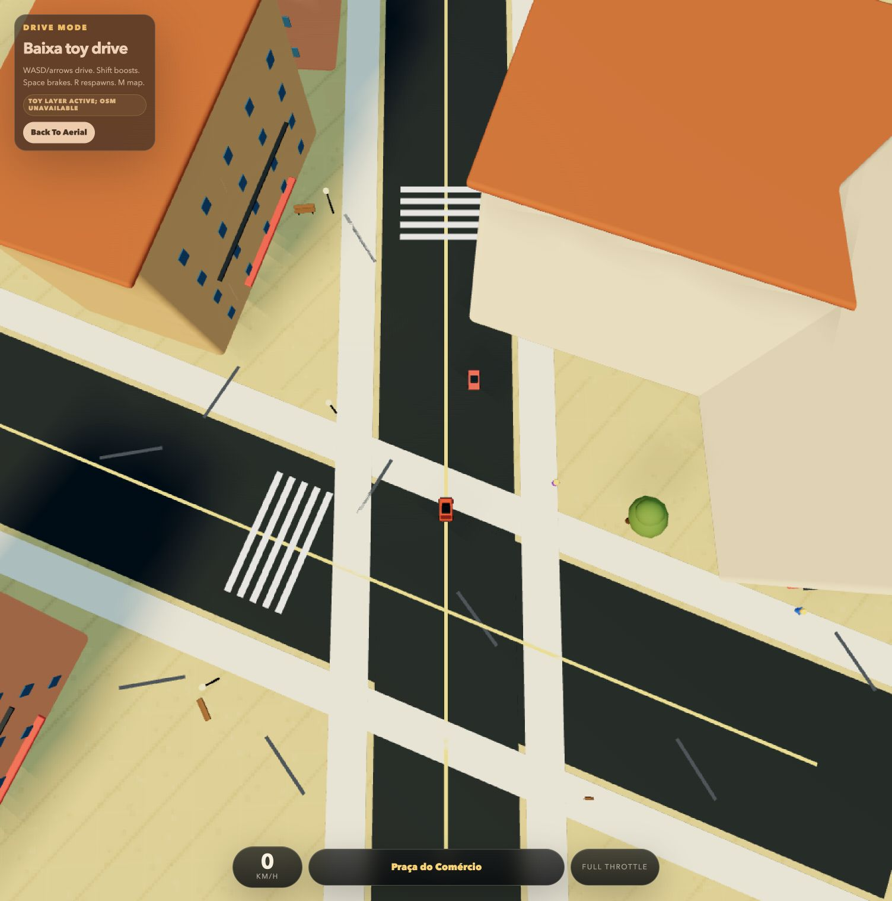

# Lisbon3D

**A tiny Lisbon you can drive through.**

A playable browser experiment that pairs a MapLibre aerial map with a toy-like
Three.js driving world. It explores how real street geography can become a small,
readable game space rather than a full city simulation.



<sub>Actual local browser capture. The native Godot prototype is a separate work in progress.</sub>

## Run locally

Use Node.js 22+ and npm. From the repository root:

```bash
git clone https://github.com/scaiado/lisbon3D.git
cd lisbon3D
npm ci
npm run dev
```

Open the local URL printed by Vite and choose **Enter Drive Mode**.
The current entry point does not require a MapTiler key.

```bash
npm run build
npm run preview
```

## Explore

| Control | Action |
| --- | --- |
| WASD / arrow keys | Drive and steer |
| Shift | Boost |
| Space | Brake |
| R | Respawn |
| M / Back To Aerial | Return to the map |

The aerial map uses OpenStreetMap tiles. The driving world can load roads,
buildings, water, and greenery through Overpass, caching the geographic slice in
browser storage. If that request fails, the app keeps its procedural fallback.

## Status and limits

This is a prototype, not a geographically precise model of Lisbon. Building
heights may be inferred; driving, collisions, and street geometry are simplified.
WebGL is required. Map tiles and fresh OSM data require network access, and public
services can be unavailable or rate-limited.

The previously advertised Lisbon subdomain currently serves the Tiny Little Lab
homepage, so this README points to the reproducible local app instead of claiming
a live game deployment. The screenshot above shows the browser version, not a
finished native release.

## Native experiment

A separate Godot project lives in [`game/godot`](game/godot/README.md).
Open `game/godot/project.godot` with Godot 4.6.x; the committed sample data allows
a first run without fetching a new city slice. See its README for the optional
Node.js 24+ exporter workflow.

## Data and attribution

Geographic data comes from OpenStreetMap contributors; its licensing and
attribution requirements still apply. The current browser entry point uses
MapLibre and Three.js. Earlier terrain and design explorations remain in the
repository; their plans do not describe every feature of the current app.

---

A [Tiny Little Lab](https://www.tinylittlelab.com/) experiment by Sérgio Caiado.
